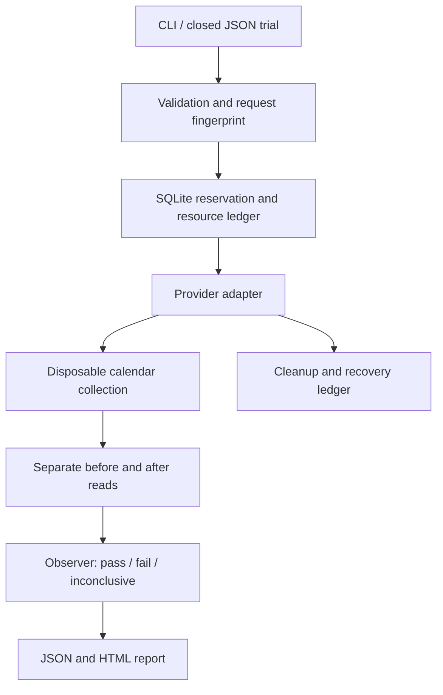

# First increment architecture

The product plan is the source of scope. This increment implements its CLI and local
execution foundation; REST, MCP, shared tenants, and the hub are future increments.

## Boundaries

- `models.py` defines a closed operation vocabulary. No generated code, shell snippets,
  arbitrary URLs in trial definitions, attendee fields, or unbounded recurrence are accepted.
- `engine.py` owns execution order and result provenance. Provider write responses are ignored
  by the observer. An invalid baseline stops the mutation.
- `observer.py` owns assertions. Identity is `(series UID, original occurrence start)` rather
  than a provider's event ID. Duplicate, missing, or foreign identities cannot pass.
- `adapters/` own provider-specific mutation and read paths. The Radicale adapter uses server
  recurrence expansion; it does not reconstruct a successful observation from the expected fixture.
- `store.py` owns transactional reservations and a cleanup intent persisted before provisioning.
  A single-process file lock is used on Linux/macOS. SQLite is local and single-owner, not a
  tenant authorization boundary. Do not expose it as a shared service.
- `report.py` produces a self-contained, script-free HTML report. Provider strings are escaped.

## Evidence

Each candidate records the test and fixture fingerprints, adapter and observer versions,
non-secret service profile, evidence level, timestamps, acceptance checks, before/after
snapshots, cleanup status, and the SHA-256 of the observations. The hash is an integrity
fingerprint, not a trusted signature. The recorded profile reports provider version `unknown`
until a version observation is implemented.

An `expires_at` timestamp is included as a pilot validity bound of 24 hours. There is no
cross-run evidence cache or hub yet. An idempotent retry returns the historical report even
after that timestamp; it never claims to be a fresh observation.

## Operational limits

Trials allow 2–12 weekly occurrences, one move up to 24 hours, and 1–4 distinct candidates.
Fixture and target times that fall into a DST gap or ambiguous local time are rejected.
The HTTP client allows 24 requests per adapter, a ten-second socket timeout, and at most
1 MiB per response. Redirects and implicit proxy use are disabled. Writes are never retried
automatically. These are request limits, not an independently enforced worker wall-clock
deadline or network sandbox; those require a separately isolated worker in the pilot.

After an ambiguous write with a baseline, one read attempts reconciliation. This increment
still reports `inconclusive`, stores any observation, and attempts cleanup. Cleanup has its
own request budget. Failed cleanup is quarantined and requires explicit retry. A provisioning
conflict never grants permission to delete an existing resource.

## Before shared pilot use

Add authenticated tenant scoping, isolated workers, explicit egress policies, secret injection,
deadlines, cancellation, audit retention/deletion, queue leases, and bounded reconciliation.
The plan proposes raw retention of seven days and summary retention of thirty days; the
local CLI does not implement scheduled retention or tenant deletion yet. Reports contain only
synthetic test data and should still be treated as local private artifacts.
