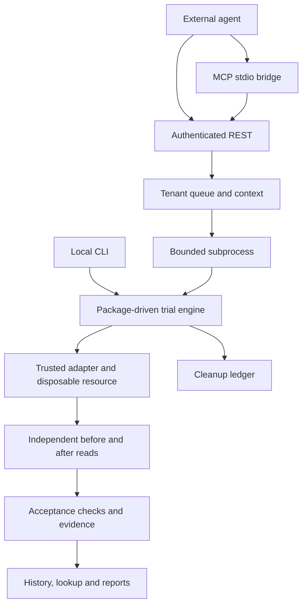

# Trial architecture

Proofbeak is a generic acceptance-trial service. The external agent/model runtime supplies a
closed condition and candidates; registered packages define the domain. The CLI can execute
synchronously, while REST/MCP use a tenant-bound durable queue and bounded worker subprocesses.
The local image and the filesystem package require no inference service or product account.

## Execution and trust boundaries

The versioned calendar and storage packages own their closed schemas, baseline validation and
domain metrics. The core engine owns reservation, provenance, ordering, independent reads,
cleanup and result persistence. Trial requests cannot import code, select arbitrary URLs,
supply credentials, choose executables or bypass a tenant provider allowlist. Operators register
trusted adapters and worker codecs explicitly.

Each REST job receives a per-run resource ledger. Reservations and cleanup intent are written
before provider mutations. Service and ledger locks prevent duplicate writers and cleanup racing
an active worker. An interrupted mutation is not replayed automatically. A provisioning conflict
does not authorize deletion of another resource. Ambiguous writes may receive one independent
reconciliation read, but still remain inconclusive until the condition can be established.
Cleanup state stays separate from pass/fail/inconclusive.

The coordinator authenticates API-key digests, scopes all data routes to a tenant, applies queue
budgets and dispatches fresh subprocesses. Credentials travel through private stdin, not argv,
persistent job manifests or inherited cloud environments. A child has its own deadline and
parent watcher; cancellation, crashes and timeouts preserve cleanup intent. See
[agent interfaces](agent-interfaces.md) and [worker limits](worker-processes.md).

## Evidence and explicit reuse

Reports include exact test/fixture fingerprints, package/adapter/observer versions, non-secret
provider profiles, timestamps, checks, raw observations and cleanup status. Injected transports
and fault controls are simulations. A local filesystem trial establishes that adapter's behavior,
not remote object-storage capability. The Google adapter has protocol tests; an actual dedicated
Google account comparison is still pending.

Observation hashes detect changes to normalized raw records. They are not signatures, trusted
attestation or provider certification. An unobserved provider version remains unknown and is
subject to a bounded validity window. No observation is refreshed by retrieving it.

The service exposes tenant history and explicit exact-context evidence lookup. Reuse excludes
expired, revoked, simulated, inconclusive, corrupt, redacted and context-drifted results.
POST /runs always requests execution; lookup does not conceal a new write. An idempotent retry
can retrieve its historical run even after observation expiry, without calling that evidence
fresh. Package/profile/observer/executor changes invalidate request context as documented in
[evidence lifecycle](evidence-lifecycle.md).

Candidate resource measurements include wall time, worker CPU and instrumented provider HTTP
attempts through cleanup. External agent decision latency, tokens and cost remain outside the
worker and are unmeasured there. They must be collected separately for the [pilot](pilot.md).

## Persistence and lifecycle

The application owns one SQLite queue and one ledger per run. It applies seven-day raw
observation/fixture redaction to both database copies and thirty-day summary/audit retention.
Minimal idempotency tombstones prevent a deleted key from starting another provider write.
Metadata audit records exclude fixture payloads and credentials. Offline tenant purge requires
resource cleanup, exclusive service ownership and credential disabling. Standalone CLI exports,
external copies and backups do not acquire automatic service retention.

This remains a singleton deployment with POSIX ownership/locking requirements. The Helm chart
uses Recreate updates and rejects multiple replicas against the same state. An actual pod
replacement test checks persistence of run ID, evidence hash and observation timestamp.
No multi-writer, cross-DC replication or backup-restore guarantee follows from that test.

## Container and network boundaries

The digest-pinned image uses hash-locked dependencies and runs non-root. Compose/Helm configure
a read-only rootfs, bounded writable volumes and dropped capabilities. The API and its workers
share that container's filesystem and network boundary; subprocess limits are not per-trial
container, syscall or tenant network isolation. Arbitrary untrusted plugin code is unsupported.

The chart supplies ClusterIP access and configurable default-deny egress/selected ingress.
Traffic enforcement depends on the cluster CNI. The dedicated Calico test exercises actual
allow/deny transitions with positive controls; chart rendering alone is insufficient. See
[deployment checks and their limits](deployment.md). Public TLS, remote SSO/OAuth, production
provider allowlists and actual OpenShift SCC/storage admission still require the target setup.

## Product gates

Private evidence reuse primitives are implemented, but a shared catalog remains gated on real
demand from two separate teams. The offline pilot scorer prepares references and evaluates
explicitly collected data; it does not run models, recruit people or establish adoption.
The [roadmap](roadmap.md) keeps Google account verification, real developer questions,
independent A/B evaluation and fourteen-day return observations open. No public hub, pricing,
unrestricted natural-language compiler or multi-DC expansion is justified by synthetic tests.
